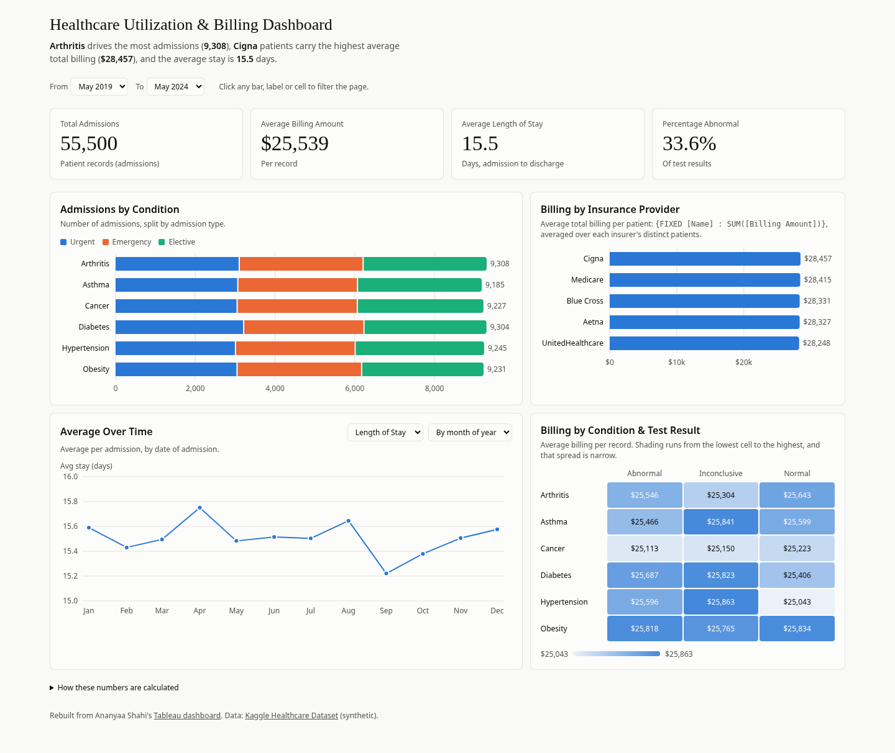

# Healthcare Utilization & Billing Dashboard

An interactive, browser-based healthcare analytics dashboard exploring **55,500 synthetic admission records**. Built as a standalone web page using **HTML, CSS, JavaScript, and D3.js**, with clickable cross-filters, a date-range selector, and a configurable time-series chart. Created as an independent, AI-assisted recreation of a publicly shared Tableau dashboard.

## Live dashboard

**[Open the interactive dashboard](https://urmillachowdary-bit.github.io/Healthcare-Utilization-Billing-Dashboard/)**

> The live link will work only after GitHub Pages is enabled and deployed for this repository.

## Dashboard preview



## Business questions

- Which medical conditions drive the largest number of hospital admissions?
- How do billing amounts differ across insurance providers?
- How do average length of stay and average billing change over time?
- How does billing vary by medical condition and test-result category?

## Charts and features

| Visualization | What it shows |
|---|---|
| Admissions by Condition | Stacked admissions counts by condition and admission type (Urgent, Emergency, Elective) |
| Billing by Insurance Provider | Mean patient-level cumulative billing, grouped by provider and using the original Tableau-style FIXED logic |
| Average Over Time | Average stay length or average billing, with a metric switch and two time-granularity choices |
| Billing by Condition & Test Result | Heatmap of average billing across condition and test-result categories |

**Interactive functionality:** Date-from/date-to controls, selections that cross-filter other charts, removable filter chips, chart hover information, and a clear-filters action. Works locally in a modern browser with no server or external JavaScript downloads.

## Data source and definitions

- Source: [Healthcare Dataset by prasad22 (Kaggle)](https://www.kaggle.com/datasets/prasad22/healthcare-dataset)
- Scope: 55,500 **synthetic** admission records; selected fields are encoded directly in `index.html` for this browser-based dashboard.
- **Total Admissions** counts admission records; this is not a distinct-patient count.
- **Average Billing Amount** is the mean `Billing Amount` per admission record.
- **Length of Stay** is the difference in days between admission and discharge dates.
- **Percentage Abnormal** is the proportion of records marked `Abnormal` in `Test Results`.
- **Insurer billing:** The dashboard recreates the logic described as `{FIXED [Name] : SUM([Billing Amount])}`. Since names are not unique identifiers, this calculation can combine different people sharing a name; interpret it as an illustrative methodology, not authoritative patient-level financial reporting.

The dataset does not establish actual insurance claim denials, reimbursements, bed-occupancy rates, or real patient outcomes. These dashboard visuals should not be treated as clinical or financial decision support.

## How to run locally

1. Download or clone this repository.
2. Open `index.html` in a recent browser (Chrome, Edge, or Firefox).
3. Use the filters and metric dropdowns to explore the charts.

No Python packages, local web server, or API keys are required.

## Files

```text
Healthcare-Utilization-Billing-Dashboard/
├── index.html             # Standalone interactive dashboard, includes chart code/data
├── dashboard-preview.png  # Screenshot of the dashboard
└── README.md              # Project overview, definitions, and usage
```

## Technology

HTML5, CSS3, JavaScript, D3.js (bundled in the HTML), GitHub Pages. The source dashboard that inspired this project was built in Tableau; **this recreation is a web application, not a Tableau workbook**.

## Inspiration & acknowledgments

This is an independent, AI-assisted recreation of [AnanyaaShahi's Healthcare Utilization & Billing Dashboard](https://github.com/AnanyaaShahi/Healthcare-Utilization-Billing-Dashboard). It draws on the publicly documented dashboard layout and analytical questions. The original author retains attribution for the inspiration. Dataset credit goes to [prasad22 on Kaggle](https://www.kaggle.com/datasets/prasad22/healthcare-dataset). Please review the dataset's permissions before redistributing or extending its records.

## Portfolio note

This project demonstrates interactive web-based healthcare utilization and billing analytics. Add any independently implemented SQL, Pandas, Tableau, or Power BI artifacts as separate files only if you have actually produced them.
